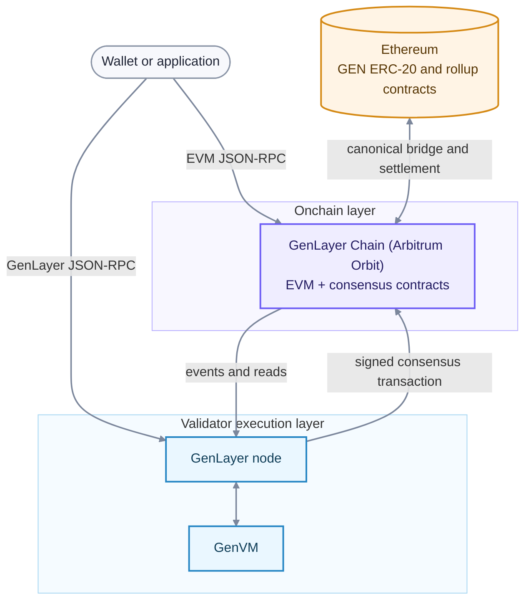

import { Callout } from "nextra-theme-docs";

# GenLayer Chain integration

GenLayer Chain is an EVM-compatible [Arbitrum Orbit](https://docs.arbitrum.io/launch-arbitrum-chain/a-gentle-introduction) chain that settles to Ethereum and uses GEN as its native gas token. It hosts ordinary Solidity contracts and the consensus contracts that coordinate Intelligent Contract execution. GenVM is a separate execution environment operated by nodes; it is not an EVM precompile or part of the rollup's execution engine.

<Callout type="info">
  Consensus v0.6 and later run on the Arbitrum Orbit GenLayer Chain. Public testnets move to it as they upgrade to v0.6; check [Networks](/developers/networks) for the current endpoints of each network.
</Callout>

## What lives on GenLayer Chain

The chain provides ordering, availability, and an authoritative state machine for consensus. Its contracts record:

- Intelligent Contract transactions and per-contract queues;
- activator, leader, and committee assignments;
- proposal, commit, reveal, decision, and appeal state;
- validator staking, fees, and penalties; and
- Ghost contracts that connect EVM accounts to Intelligent Contracts.

Because consensus actions are chain transactions, validators do not need a separate peer-to-peer network to agree on an Intelligent Contract result. Chain time and state determine whether a phase is open or a participant is idle.

## What lives in GenVM

Intelligent Contract code and state execute in GenVM. Nodes reconstruct the accepted Intelligent Contract state by following GenLayer Chain events and replaying the corresponding state transitions. The consensus contracts store commitments and lifecycle data; they do not execute Python contract logic.

## Ghost contracts bridge the environments

Every Intelligent Contract has a Ghost contract on GenLayer Chain at the same address. A Ghost:

- receives EVM transactions addressed to the Intelligent Contract;
- holds its native GEN balance on the EVM side;
- forwards Intelligent Contract calls to the consensus system; and
- delivers on-acceptance and on-finalization messages to EVM recipients.

The shared address gives wallets and EVM contracts one destination even though execution and balances span two environments. See [accounts and addresses](/understand-genlayer-protocol/core-concepts/accounts-and-addresses) and [messages](/developers/intelligent-contracts/features/messages).

## GEN on Ethereum and on GenLayer Chain

GEN is an ERC-20 token on Ethereum. On GenLayer Chain it is the **native currency**, in the same way ETH is native on Ethereum: account balances, transfers, EVM gas, staking, and Intelligent Contract fee budgets all use native GEN with 18 decimals. Accounts do not need ETH or any other token to transact on GenLayer Chain.

GEN moves between the two chains only through the chain's canonical Arbitrum bridge:

- **Ethereum to GenLayer Chain.** Native GEN deposits go through the chain's ERC-20 Inbox and are credited to the recipient once the sequencer includes them; they do not create a ticket to redeem. Messages and contract calls, including the protocol's inflation deliveries, are sent as *retryable tickets*. A retryable is normally redeemed automatically on GenLayer Chain. If automatic redemption fails, anyone can redeem it manually before it expires.
- **GenLayer Chain to Ethereum.** Withdrawals and messages leave through the `ArbSys` system contract. They can be executed on Ethereum through the Outbox only after the rollup assertion that contains them is confirmed, which happens after the chain's challenge period. A sequencer receipt or an L2 event alone cannot authorize an action on Ethereum.

The protocol uses the same path for its own token flows. Inflation is minted on Ethereum and delivered to the staking contract on GenLayer Chain as a retryable ticket; staking acknowledgements and burns travel back through the Outbox. These steps are permissionless—see [network keeper roles](/validators/network-keeper-roles).

## Blocks, time, and fees

- **Block numbers.** The consensus contracts record GenLayer Chain block numbers, read through `ArbSys.arbBlockNumber()`. On Arbitrum chains, Solidity's `block.number` returns an approximate Ethereum block number instead, so do not compare it with consensus block fields. Phase windows and timeouts use block timestamps.
- **EVM gas.** Gas on GenLayer Chain covers execution on the chain plus the cost of posting transaction data to the parent chain. Both components are charged in GEN.
- **Intelligent Contract fees.** The fee budget of an Intelligent Contract transaction is separate from the EVM gas of the enclosing transaction. See the [economic model](/understand-genlayer-protocol/core-concepts/economic-model).

## Integrating with GenLayer Chain

Exchanges, wallets, and indexers can treat GenLayer Chain as an Arbitrum-based EVM chain:

- Use standard Ethereum tooling and `eth_*` JSON-RPC methods against the GenLayer Chain RPC or the GenLayer RPC, which passes `eth_*` calls through. Chain IDs and endpoints are listed on [Networks](/developers/networks).
- Track GEN on GenLayer Chain as the native asset, not as an ERC-20 token. On Ethereum, track it as an ERC-20 token.
- Expect Arbitrum transaction types and receipt fields, such as the internal system transaction at the start of each block and `gasUsedForL1` in receipts. Current Ethereum libraries handle them; custom decoders may need updates.
- Plan for the challenge period on withdrawals to Ethereum. Native GEN deposits from Ethereum are credited once the sequencer includes them.
- Use the Intelligent Contract transaction status from the GenLayer RPC to decide whether an Intelligent Contract outcome is final, as described below.

## Settlement and protocol finality are different

GenLayer Chain transactions reach several levels of confirmation:

1. **Sequencer inclusion.** The chain's sequencer orders the transaction into a block. This is the confirmation most EVM tooling reports.
2. **Ethereum settlement.** The chain posts its transaction data and state assertions to Ethereum. An assertion is confirmed after the challenge period; only then can its withdrawals and messages execute on Ethereum.
3. **Protocol finality.** An Intelligent Contract transaction is final only after its consensus decision and appeal window complete.

Applications must use the Intelligent Contract transaction status—not only the enclosing EVM transaction receipt—to determine whether an outcome is final. See [finality](/understand-genlayer-protocol/core-concepts/optimistic-democracy/finality).
